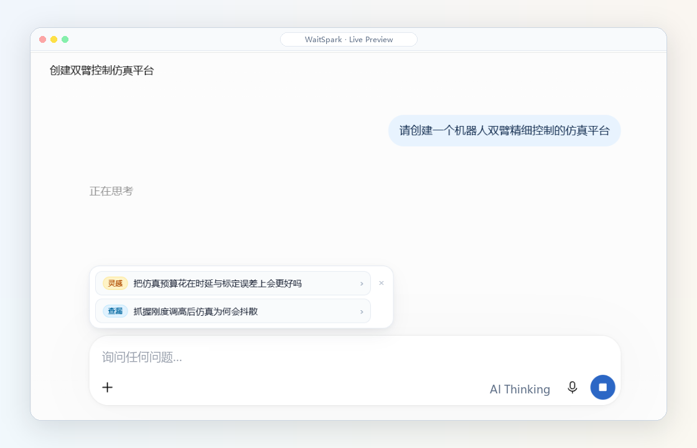

# WaitSpark

> **Wait-Learning 2.0 for AI Chat** — 把 AI 思考的等待死时间，变成聊天框正上方 1~2 条克制的浅色 **「灵感」** 与 **「查漏」** 微气泡，守住专注力与心流，告别等待期脑雾。

[](https://github.com/Yizhizhii/WaitSpark/actions/workflows/ci.yml)
[](extension/manifest.json)
[](LICENSE)

---

## 为什么开发 WaitSpark？（开发动机）

随着深度推理模型（Deep Thinking）、Deep Research 与长程 Coding Agent 的普及，我们和 AI 协作的节奏已经彻底变了：**发完一条复杂指令，往往要经历几十秒、几分钟甚至几十分钟的「长时间等待」**。

这些尴尬的**碎片化时间**——说长不长，不够完整投入另一件硬核工作；说短不短，干盯着“正在思考…”又极度煎熬。于是大多数人自然滑向两种同样伤神的陷阱：

1. **多终端、多任务并行切换 → 上下文频繁切换，心流碎裂**
   为了“不浪费时间”，很多人会同时开三四个终端或对话框来回横跳。表面上并行度拉满，实际上每次切换都要在大脑里重新装载变量、约束和分支状态——**上下文频繁切换**让工作记忆持续过载，**专注力**被悄悄抽干，原本难得进入的**心流（Flow）**彻底断裂。
2. **随手刷手机 / 信息流 → 陷入「脑雾（Brain Fog）」**
   另一种本能反应是切出去刷短视频、看消息。结果等 AI 终于思考完成、吐出一长段精妙方案时，大脑已被高刺激碎片信息冲散，回到屏幕前陷入明显的**脑雾**——连刚才为什么提这个问题、关键边界条件是什么都要重新读一遍才能接上。

**WaitSpark 想解决的，正是这个“等待死时间”里的认知断层：**

受到 MIT CSAIL 经典 HCI 论文 *Wait-Learning / WaitChatter*（CHI 2014 / 2015）与主动回忆微测验（Active Recall Quiz）的启发，WaitSpark 不把你拉离当前页面，也不鼓励你再开一个新窗口，而是**就在等待发生的原地——聊天框正上方**——静默思考后浮出仅 1~2 条紧扣当前任务上下文的微气泡：

- 一条反直觉的 **「灵感」**，帮你在同一认知频道里向外延展半步；
- 一道直击盲区的 **「查漏」** 微考题，让你在 15 秒内激活主动回忆、提前校准直觉。

当你读完气泡、切回 AI 刚刚生成的完整回复时，**大脑始终留在同一条心流轨道上**——不仅没有脑雾和切换损耗，反而比按下发送键前更清醒、更有洞察。

---

## 实际使用效果

当主对话进入 **「正在思考」** 的等待空窗期，WaitSpark 在后台静默思考完毕后，于聊天输入框正上方以柔焦微动效浮出极简浅色气泡（仅保留 `灵感` + `查漏` 两条核心问题，零多余顶栏，点击原地向上展开详答或 A/B/C 互动测验，单击折叠收起或关闭）：

<p align="center">
  
</p>

---

## 核心特性

- **静默思考，好了再弹**：发消息后全程隐藏（无加载条、不抢焦点）；仅在模型真正完成思考并输出有效结构化内容后才优雅浮现。
- **极简 1~2 条，零冗余顶栏**：折叠态去掉一切标题噪音，只留 1~2 条高钩子问题：
  - **`灵感`**（暖琥珀徽章）：挑战当前方案隐含假设的反直觉 *What if...* 设问，点击原地向上展开 200~320 字高密度解答；
  - **`查漏`**（清天蓝徽章）：围绕当前任务底层原理与隐形坑点的 3 选 1 微考题，点选即时给出薄荷绿/淡红直觉反馈并展开第一性原理详解（支持「跳过作答，直接看详解 ↓」）。
- **优雅微动效 & 零样式污染**：
  - 独立 **Shadow DOM** + 纯白微磨砂玻璃质感（`backdrop-filter`），原生融入浅色聊天界面；
  - 减速弹性浮现 + 错落入场、平滑原地向上展开、轻雾淡出关闭；
  - 单击顶部 `收起 ▾` / 题干 / 底部 `▾ 折叠收起` 折回小气泡，点 `×` 关闭，点 `填入聊天框追问 ↗` 一键回填输入框。
- **跨平台零构建**：纯原生 HTML / CSS / JS（Manifest V3），**macOS / Windows / Linux** 上的 Chrome、Edge、Arc、Brave 均开箱即用。

---

## 快速安装（macOS / Windows / Linux）

### 方式 1：直接下载 Release 压缩包（最简单）

1. 前往 [**Releases**](https://github.com/Yizhizhii/WaitSpark/releases) 下载最新版 `waitspark-chrome-extension-v*.zip` 并解压；
2. 打开浏览器扩展管理页（Chrome：`chrome://extensions`，Edge：`edge://extensions`，Arc：`arc://extensions`）；
3. 开启右上角 **「开发者模式」** → 点击 **「加载已解压的扩展程序」** → 选中解压后的文件夹即可。

### 方式 2：从源码加载

```bash
git clone https://github.com/Yizhizhii/WaitSpark.git
```

在浏览器 `chrome://extensions` 开启开发者模式，点击 **「加载已解压的扩展程序」**，选择仓库内的 **`extension/`** 目录即可（无需 `npm install` 或构建）。

---

## 模型配置

点击浏览器工具栏的 **WaitSpark** 图标即可配置（所有 Key 仅保存在本机浏览器的 `chrome.storage.local`）：

| 模式 | 说明 | 推荐模型 |
| :--- | :--- | :--- |
| **离线演示模式** | 免 API Key，装完即可体验完整交互与动效 | 内置 |
| **OpenAI / 兼容中转** | 支持官方 OpenAI 及任意兼容端点（推理模型自动开启 `reasoning_effort: "medium"`） | `gpt-5.2` / `gpt-5` / `gpt-4.1-mini` / `o3` |
| **DeepSeek** | 内置 `https://api.deepseek.com/v1` 预设 | `deepseek-chat` / `deepseek-reasoner` |
| **Google Gemini** | 内置 `responseMimeType: "application/json"` 防截断 | `gemini-2.5-flash` |
| **Anthropic Claude** | 已内置浏览器侧所需请求头 | `claude-3-5-haiku-latest` |
| **本地 Ollama** | 免 Key，纯本机推理（自动补齐 `/v1`） | `qwen2.5:7b` 等 |

点击弹窗中的 **「测试模型」** 可实时检测接口连通与返回状态，点击 **「预览气泡」** 可在当前 AI 聊天页立即预览。

---

## 项目结构

```text
WaitSpark/
├── extension/              # 可直接加载到 Chrome / Edge / Arc 的 Manifest V3 扩展本体
│   ├── manifest.json
│   ├── background.js       # Service Worker：静默调用模型、JSON 清洗与重试容错
│   ├── content.js          # Shadow DOM 浅色磨砂气泡、4 重发送检测与微动效
│   ├── popup.html          # 浅色系设置弹窗
│   ├── popup.js
│   └── icons/              # 16 / 48 / 128 PNG 图标
├── docs/assets/            # 美化与脱敏后的首页展示图
├── tests/
│   └── background.test.mjs # 零依赖 Node 内置测试（node --test）
├── scripts/
│   └── pack.mjs            # 一键生成 macOS / Windows 兼容发布压缩包
└── .github/workflows/
    └── ci.yml              # GitHub Actions 语法与单元测试 CI
```

## 本地测试与打包

需要 Node.js 20+（零外部依赖）：

```bash
node --check extension/background.js extension/content.js extension/popup.js
node --test
node scripts/pack.mjs
```

---

## 隐私说明

- API Key 与模型配置仅保存在本地浏览器的 `chrome.storage.local`；
- 仅在你发送消息时，由浏览器后台直接向你配置的模型服务商请求生成气泡内容，不经过任何第三方中转或自建服务器。

## 致谢与学术灵感

- Carrie J. Cai, Philip J. Guo, James Glass, Robert C. Miller. *Wait-Learning: Leveraging Conversational Dead Time for Second Language Education* (ACM CHI 2014 / 2015, MIT CSAIL).
- Active-recall micro-quiz workflows for AI coding sessions.

## License

[MIT](LICENSE)
